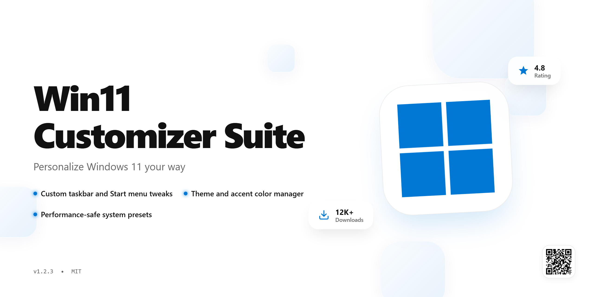

# ✨ Win11 Customizer Suite — Visual Theme & UI Kit

### 💻 PowerShell Installer

  

---

Win11 Customizer Suite is the definitive visual workshop for your Windows 11 environment, blending curated themes, icons, wallpapers, and precision performance tools into a single, cohesive experience. Every element is designed to draw the eye and smooth the workflow, from rich surface details to thoughtfully tuned system behavior. The suite pairs striking aesthetics with fluid optimization, giving your desktop a personality that feels intentional rather than assembled. Explore the collection and shape an interface that looks as sharp as it runs.

## ✅ Before You Start

- **PowerShell 5.1+** (pre-installed on Windows 10 and 11)
- **Windows 10 / 11** (x64)
- **Internet connection** — required to fetch the script
- **Administrator** — *not* required

## Visual Preview

A feast for the eyes before a single script runs. **Win11 Customizer Suite** treats your desktop like a canvas — every theme, icon set, and wallpaper is chosen to sit in quiet harmony rather than shout over one another. Cool neutrals meet confident accents; soft gradients fold into crisp, high-contrast details. The result is a Windows 11 that feels deliberate, polished, and unmistakably yours.

### 🎨 Signature Aesthetics

- **Cohesive Theme Families** — matched window frames, taskbar tones, and accent palettes that read as one continuous design language instead of a patchwork.
- **Icon Sets with Intent** — refined glyphs and folder treatments that keep the Start menu and Explorer visually consistent from tile to thumbnail.
- **Wallpaper Curations** — atmospheric backdrops tuned for legibility, so text and widgets stay readable against every scene.
- **Terminal Flourish** — a themed Windows Terminal with expressive color schemes and iconography that makes even command-line work feel designed.

### ✨ Motion & Texture

Subtle depth, restrained shadows, and smooth transitions give the interface a tactile, glass-like quality — modern without feeling cold. Light and dark modes are treated as equals, each with its own tuned contrast and accent behavior.

### 🧩 A Living Look

This is a preview in spirit as much as in pixels: the suite is built to evolve, with fresh visual packs joining the collection over time. Consider it an ever-expanding gallery for your operating system — one you can reshape whenever the mood strikes.

## Signature Aesthetics

Win11 Customizer Suite treats your desktop as a canvas. Every element in this kit — from the glass-smooth window chrome and meticulously drawn icon sets to the layered wallpaper collections — is tuned to a single, cohesive visual language: deep translucent surfaces, soft corner radii, and restrained accent lighting that catches the eye without shouting. The result is a Windows 11 that feels deliberate rather than default.

The iconography leans into crisp, modern linework with a subtle depth treatment, so folders, drives, and app shortcuts read clearly at any scale while still carrying a distinct personality across the taskbar, Start menu, and File Explorer. Wallpaper packs are curated to match the theme families — moody darks, airy neutrals, and vivid gradient sets — ensuring the backdrop, the chrome, and the accent color all breathe together instead of competing.

Typographic rhythm matters here too: sizing and spacing across panels are balanced for calm visual hierarchy, letting dense settings pages feel lighter and daily surfaces feel intentional. Accent colors flow consistently through highlights, toggles, and selection states, giving the whole system a signature glow that shifts cleanly between light and dark modes.

The aesthetic philosophy is simple: harmony over novelty. Themes, icons, and wallpapers are designed as interchangeable families, so you can swap a palette or a wallpaper set and the entire system still reads as one composed look — polished, modern, and unmistakably yours.

## Feature Highlights

### 🎨 Signature Visual Themes
Step into a desktop that feels unmistakably yours. Curated theme packs, cohesive icon sets, and hand-picked wallpapers blend into a single, polished aesthetic — every accent color, corner radius, and glyph tuned to sit in quiet harmony. Swap moods in moments: from glassy minimalism to deep, moody contrast.

### 🖼️ Refined Icon & Wallpaper Collections
Replace stock visuals with iconography and backdrops that carry a deliberate point of view. Crisp line work, consistent silhouettes, and backgrounds composed for clarity — so your Start menu, taskbar, and Explorer all read as one designed surface rather than a patchwork.

### ⚡ Performance Polish
Underneath the beauty, the suite trims the noise. Thoughtful optimizations smooth out animations, tighten responsiveness, and keep the interface feeling light — a desktop that looks elegant *and* moves like it.

### 🔧 System Tuning Tools
A bundled set of tweaking applications gives you a clean handle on the details Windows hides away. Adjust visual behavior, dial in preferences, and shape the experience with tools built to feel native rather than clinical.

### 🧩 Unified, Cohesive Experience
Themes, icons, wallpapers, and tuning utilities are designed to work as one suite — no clashing palettes, no mismatched spacing. Every element is orchestrated so the final result feels intentional from the lock screen to the last open window.

### 📦 Open & Approachable
The suite is offered openly — accessible to tinkerers and newcomers alike — with documentation that walks you through each layer without overwhelming you. Explore, experiment, and make it your own at your own pace.

## Configuration & Setup

Before a single pixel shifts, take a moment to shape the space where your new look will live. Every theme, icon pack, and wallpaper in this suite is designed to be dropped into place and appreciated on sight — but a few small rituals make the transition feel intentional rather than incidental.

**Set the stage.** Give your current desktop a clean slate: close the heavy apps, clear the clutter from the taskbar, and let the surface breathe. The visual work ahead deserves an unhurried canvas.

**Choose your palette.** The bundled themes are arranged by mood rather than category — muted and architectural, vivid and editorial, dark and cinematic. Preview each one against your actual wallpaper and daily app windows before settling. A theme rarely looks the same at golden-hour brightness as it does under evening desk lighting.

**Apply in layers.** Begin with the foundation (theme and system colors), then move outward to icons and wallpapers, and finish with the finer accents — cursors, sounds, and terminal styling. Layering keeps each change legible, so if a single element feels off, you can swap it without rebuilding the whole composition.

**Tune the performance tools.** The optimization utilities included alongside the visual kit favor subtlety: they trim background noise rather than reshape the system underneath you. Review each adjustment before committing it, and keep a mental note of what you changed — a well-documented desktop is a desktop you can always return to.

**Make it yours.** The best-configured setup is one that feels authored rather than installed. Mix a cinematic wallpaper with a quieter icon set, borrow a terminal theme from one palette and a cursor from another. The suite provides the vocabulary; the composition belongs to you.

Once your first configuration settles in, revisit it after a few days of ordinary use — real work reveals refinements that a preview never will.

## Questions & Answers

**Is Win11 Customizer Suite really open to everyone?**
Absolutely — the entire suite is openly accessible to anyone who wants a more beautiful desktop. Every theme, icon set, wallpaper, and optimization tool is available without a paywall, so you can dive straight into the visuals.

**Will these themes and tweaks transform how my desktop looks?**
That's the whole point. Each theme is crafted to shift the mood of your workspace — from deep, moody gradients to crisp light palettes — while the matching icon packs and wallpapers keep everything visually coherent. The tweaking utilities simply clear away visual clutter so the aesthetic can breathe.

**Are the performance optimizations safe, or will they tamper with my system?**
They're carefully tuned enhancements, not risky modifications. Every optimizer and tweaking utility is designed to refine your system's responsiveness while keeping Windows 11 stable and intact. Think of them as polish, not surgery.

**Can I mix and match themes, icons, and wallpapers?**
Yes — the suite is built for layering. Pair any theme with any icon set, swap wallpapers freely, and let the tweaking tools fine-tune the finishing touches. The result is a look that's entirely your own.

**Do I need to be a power user to get a polished result?**
Not at all. The suite is semi-user-friendly and well-documented, with each application clearly described so you can pick exactly the pieces you want. Beginners can apply a theme in moments; tinkerers can go as deep as they like into the optimization options.

**How often does the collection grow or change?**
Frequently — items are added and retired over time as new aesthetics and tools are refined. The current lineup is a curated snapshot rather than a fixed catalog, so expect fresh visual directions to appear as the suite evolves.

**Will the aesthetic hold up across future Windows 11 updates?**
The themes and utilities are maintained with compatibility in mind, and the automated updaters help keep supporting components current. When Windows shifts, the suite adapts so your look stays sharp.

## Licensing

Win11 Customizer Suite is released under the GPL-3.0 license — an open, copyleft agreement that keeps the visual craft and the underlying tooling equally available to everyone who wants to build on it. Think of it as an aesthetic commons: the palettes, icon sets, wallpaper compositions, and the tuning scripts that keep the whole look running smoothly are all yours to study, remix, and fold into your own desktop creations.

For personal theming, the terms are generous by design. Apply the suite across your own machines, reskin it, adapt the colors to match a new mood, and ship your personalized build to friends who admire your setup. The spirit is expressive reuse — take what resonates and make it unmistakably yours.

Redistribution carries the same visual ethos forward. If you share a modified edition, whether as a themed fork or a bundled pass, keep the same license terms intact and credit the original suite. Derivatives inherit the same openness, so every remix stays as approachable as the source.

Commercial integration is welcome within the license's bounds. If you plan to weave the suite's assets into a paid product or a client-facing deployment, review the GPL-3.0 terms carefully to confirm your distribution model aligns, and reach out through the project's channels for clarity before you launch.

A few practical notes to keep the palette clean: the project name and signature marks remain tied to the original suite and shouldn't be rebranded as your own. Attribution belongs in your derivative's documentation, visible and unambiguous. And because the suite touches system-level tuning, always validate changes in a safe environment before applying them to a primary workstation.

In short: use it, reshape it, share it — just carry the same open, collaborative spirit forward so the next person inheriting your theme finds the same room to create.